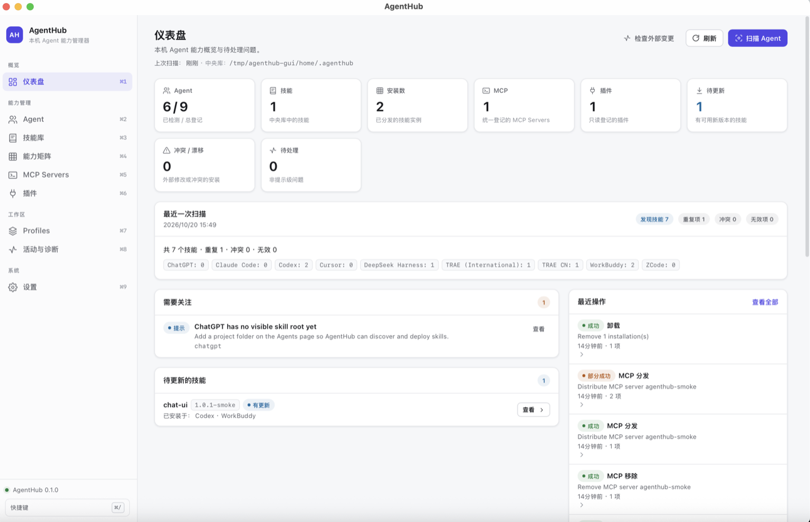
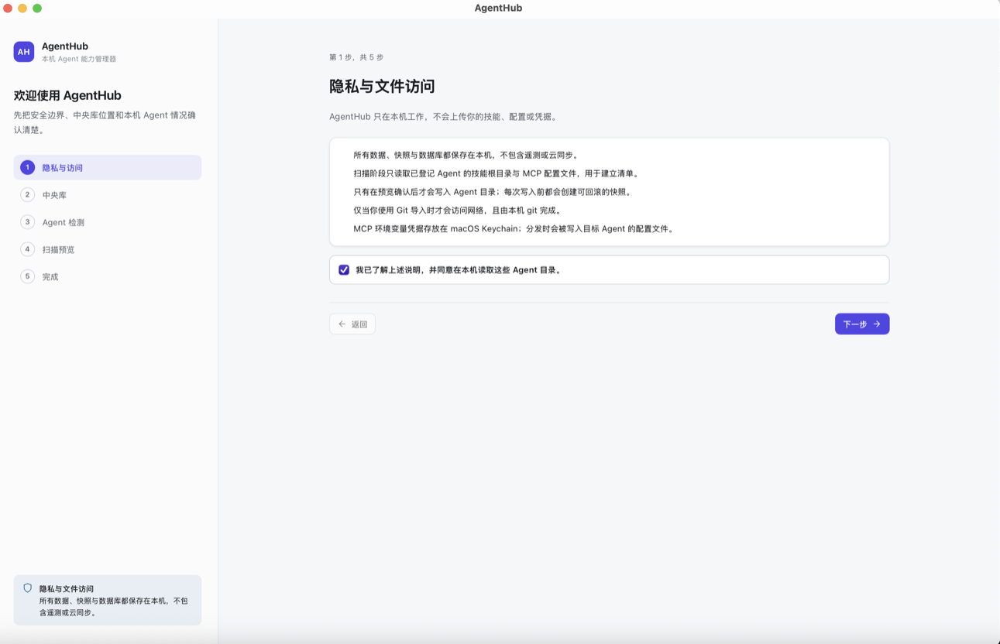
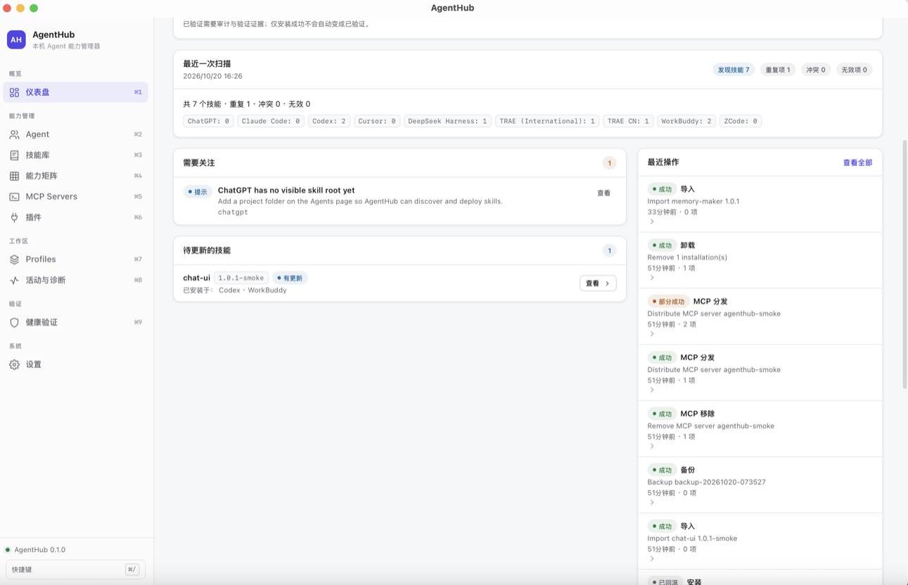

<div align="center">


# AgentHub · Capability Control Center

**本机 Agent 能力控制中心** — 集中登记散落在各 AI Agent 目录里的 Skills / MCP / 插件，事务化分发、快照回滚、验证留痕。

`macOS 11+ · Apple Silicon` · [下载安装包](https://github.com/qomob/agenthub/releases/latest) · License: [MIT](LICENSE)

</div>

---

AgentHub 是**本地优先**的 macOS 桌面应用（Tauri 2 + Vue 3 + Rust + SQLite）：无账号、无云端、无遥测。GUI 与 CLI 共用同一个 `agenthub-core` 引擎，行为一致。

## 界面截图

| 仪表盘 | Onboarding（隐私与文件访问） | 健康验证 |
|---|---|---|
|  |  |  |

## 它解决什么问题

Skills 和 MCP 配置散落在 `~/.codex`、`~/.trae`、`~/.workbuddy` 等各自的目录里，格式互不相同，装没装、装了哪个版本、更新会不会弄坏现有环境，全靠人记。AgentHub 把这些变成一张清单：

- **扫描发现**：只读扫描所有已登记 Agent 的技能根与 MCP 配置，跨 Agent 按 `(slug, 内容哈希)` 去重
- **中央库**：一份不可变版本（`library/skills/<slug>/<hash12>`），Agent 目录只是部署副本
- **事务化分发**：计划 → 预检 → 快照 → 写入 → 校验 → 日志；失败自动逆序补偿，支持操作级回滚
- **两步审批**：对真实 Agent 目录的写入需要 plan_hash 绑定的一次性 approval token（15 分钟过期）；目标被外部修改时 CAS 拒绝、不覆盖
- **验证留痕**：静态审计 + 依赖诊断 + 更新影响分析 + 人工验证证据；「安装 ≠ 可用 ≠ 已验证」
- **跨进程互斥**：GUI 与 CLI 并发修改共享数据库/Agent 目录时互斥，锁随进程崩溃自动释放
- **隐私边界**：诊断导出自动剥离 URL query、argv 秘密与主目录路径；MCP header 值只存 macOS Keychain

## 支持的 Agent（11 个内置适配器）

Codex · ChatGPT · TRAE (International) · TRAE CN · ZCode · WorkBuddy · DeepSeek Harness · Claude Code · Cursor · Qwen Work · Doubao Work

每个 Agent 的路径/格式/能力差异集中在 `AgentAdapter`；未验证的能力显式标 `Unverified` / `VerificationRequired`，不做假装集成。详见 [docs/ADAPTER-SPEC.md](docs/ADAPTER-SPEC.md)。

## 安装

从 [Releases](https://github.com/qomob/agenthub/releases/latest) 下载 `AgentHub_0.5.0_aarch64.dmg`，打开后把 **AgentHub.app** 拖入 `Applications`。

> 当前构建未做 Apple 签名与公证，首次打开 Gatekeeper 会提示无法验证：在 Finder 中**右键 AgentHub.app → 打开**，或执行 `xattr -cr /Applications/AgentHub.app`。

校验完整性：

```bash
shasum -a 256 AgentHub_0.5.0_aarch64.dmg
```

## CLI 快速上手

```bash
./scripts/cargo.sh build -p agenthub-cli
BIN=./target/debug/agenthub

$BIN doctor              # 本机诊断（库、数据库、Agent 检测）
$BIN agents list         # 已登记 Agent 与安装状态
$BIN skills scan         # 只读扫描所有 Agent 技能根
$BIN skills import --path <目录|zip|SKILL.md>   # 导入中央库
$BIN skills install <skill-id> --agents codex   # 先打印计划，加 --yes 才写入
$BIN backup create       # 元数据库备份
```

完整命令与参数见 [docs/CLI.md](docs/CLI.md)。

## 从源码构建

| 依赖 | 要求 |
|---|---|
| 系统 | macOS，Apple Silicon |
| Node.js / pnpm | ≥ 20 / 10.x |
| Rust | rustup stable（**用 `./scripts/cargo.sh` 包装器**，绕开过旧的系统 rustc） |
| Xcode CLT | `xcode-select --install` |

```bash
pnpm install
./scripts/cargo.sh test -p agenthub-core -p agenthub-cli   # Rust 测试
pnpm test                                                   # 前端测试
source scripts/cargo-env.sh && pnpm tauri dev               # 桌面开发
source scripts/cargo-env.sh && pnpm tauri build             # 产出 .app 与 .dmg
```

## 数据与安全

- 数据都在 `~/.agenthub/`（SQLite + 内容寻址技能库 + 快照 + 备份），可用 `AGENTHUB_HOME` / `AGENTHUB_DATA_DIR` 隔离测试
- 对真实 Agent 目录的写入默认两步审批；每次写入前自动快照，可回滚
- 已知限制（未签名、备份不含 Keychain 值等）与威胁模型见 [docs/SECURITY.md](docs/SECURITY.md)

## 文档

[架构](docs/ARCHITECTURE.md) · [数据模型](docs/DATA-MODEL.md) · [适配器规格](docs/ADAPTER-SPEC.md) · [验证方法论](docs/VALIDATION.md) · [变更日志](docs/CHANGELOG.md) · [CLI](docs/CLI.md)

## 贡献

见 [CONTRIBUTING.md](CONTRIBUTING.md)：spec → plan → 实现，行为改动必须带测试（core 用 Rust，前端用 vitest），Conventional Commits。

## License

[MIT](LICENSE) · 版权所有者确认于 2026-10-29 · 依赖许可见 [THIRD_PARTY_NOTICES.md](THIRD_PARTY_NOTICES.md)
