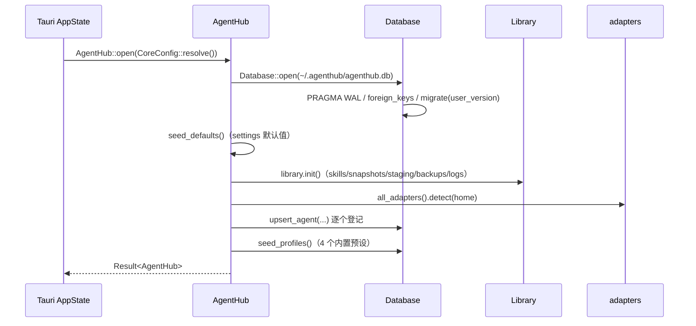
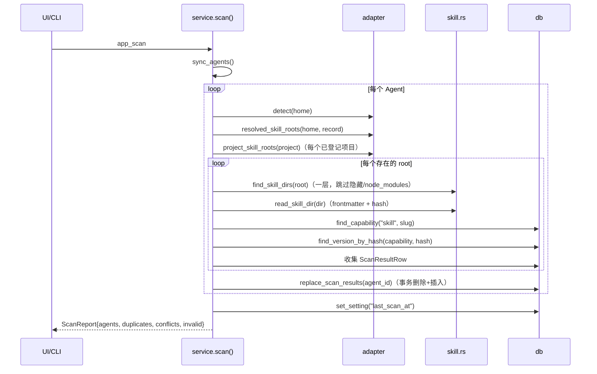
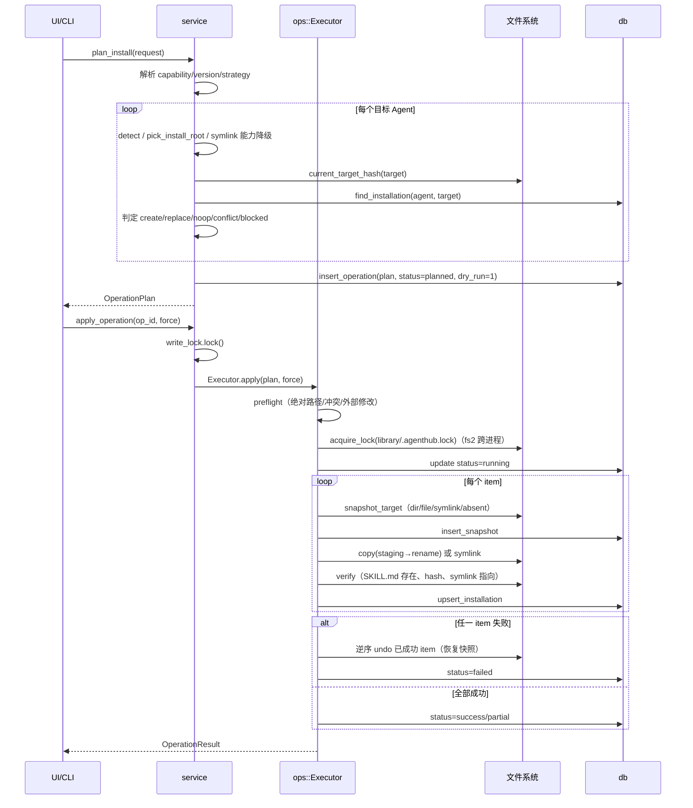
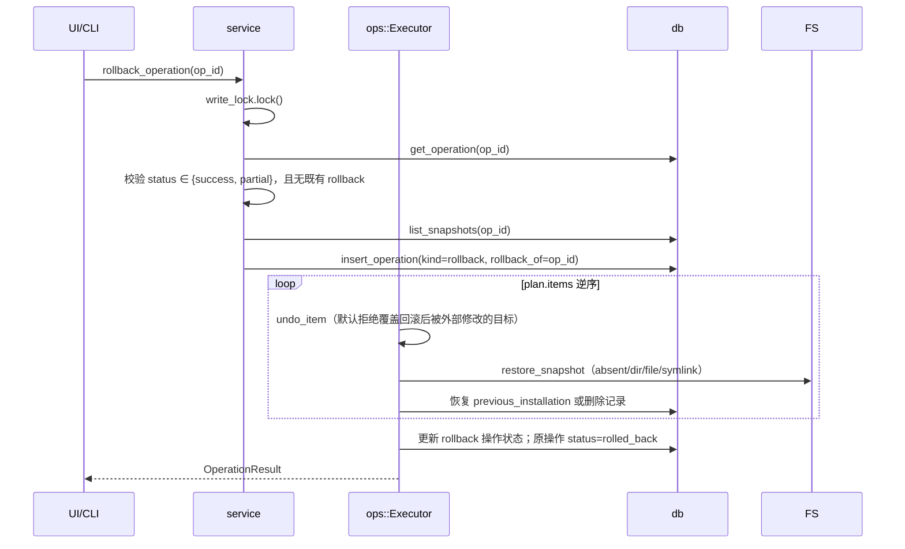
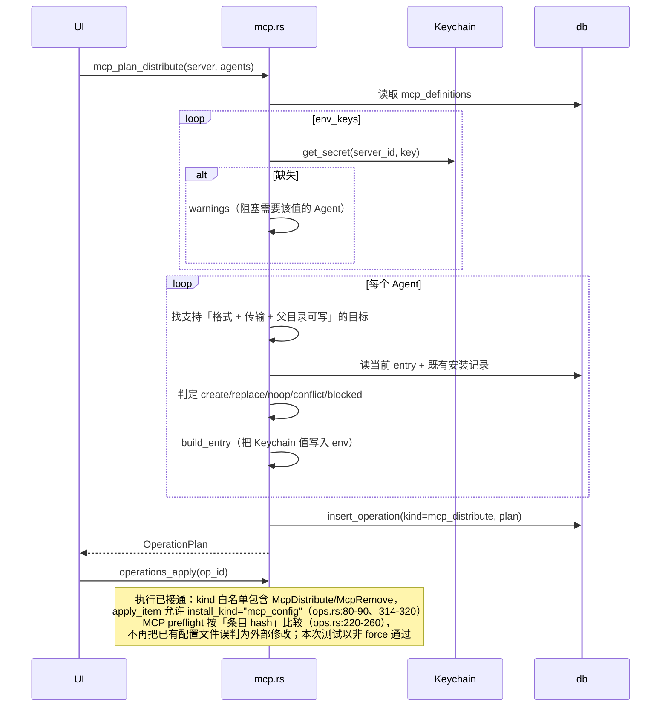
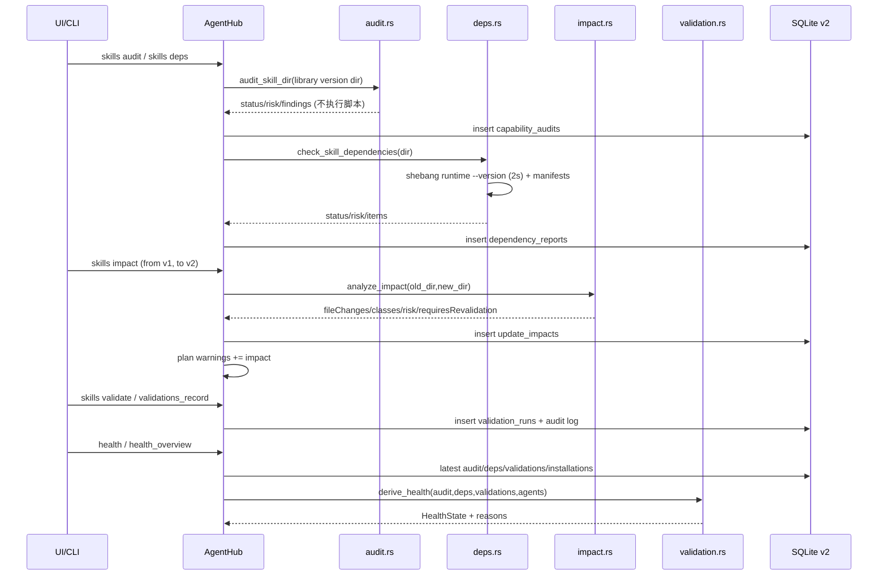

# AgentHub 架构设计

> 状态基准：2026-10-20。本文以 `crates/agenthub-core/src`、`src-tauri/src/lib.rs` 的实际代码为准。
> 标记：**已验证** = 代码实现存在且本次阅读确认；**未验证** = 有代码但有已知缺陷或缺少运行验证；**未实现** = 尚无代码。

---

## 0. 一页总览

AgentHub 是「本地 Agent 能力控制中心（Capability Control Center）」：把 Skills、MCP 定义、插件清单集中登记，通过 **adapter + 事务化写入器** 分发，并用 **验证平台** 回答「能不能用、安不安全、更新后会不会坏」。核心不是文件同步器，而是四件事：

1. **能力注册表**（SQLite）：capability / version / installation 的事实记录；
2. **适配层**（`AgentAdapter` trait）：每个 Agent 的路径、格式、能力等级；
3. **事务化分发**（`ops::Executor`）：先计划、再预检、快照、写入、校验，失败逆序补偿；
4. **验证平台**（`audit`/`deps`/`impact`/`validation`/`agent_health`）：静态审计、依赖诊断、更新影响、人工证据、Agent 版本健康。

```
┌──────────────────────────────────────────────────────────────────────┐
│ 表现层                                                               │
│  Vue 3 UI (src/**，11 路由/12 视图)  Tauri 命令层 (47 个命令)         │
│  CLI (crates/agenthub-cli，已实现，薄前端；health/audit/deps/...)     │
└───────────────────────────────┬──────────────────────────────────────┘
                                │ 同一入口：AgentHub 服务
┌───────────────────────────────▼──────────────────────────────────────┐
│ 领域服务层  crates/agenthub-core/src/service.rs (AgentHub)            │
│  bootstrap / settings / scan / import / plan / apply / rollback /     │
│  dashboard / doctor / profiles / plugins / MCP / health 门面          │
└───────┬──────────────┬───────────────┬───────────────┬───────────────┘
        │              │               │               │
┌───────▼──────┐ ┌─────▼──────┐ ┌──────▼───────┐ ┌─────▼──────────────┐
│ ops.rs       │ │ mcp.rs     │ │ skill.rs     │ │ scan.rs            │
│ 事务/快照/   │ │ 定义/发现/ │ │ 解析/校验/   │ │ 只读发现与缓存     │
│ 回滚/审计    │ │ codec/写回 │ │ 解压/克隆    │ │                    │
└──────────────┴─────────────┴──────────────┴──────────────────────┘
┌──────────────────────────────────────────────────────────────────────┐
│ 验证平台（只读/确定性）                                               │
│ audit.rs（静态规则）  deps.rs（环境/依赖）  impact.rs（更新影响）     │
│ validation.rs（健康状态机）  agent_health.rs（版本/路径健康）         │
└───────────────────────────────┬──────────────────────────────────────┘
                                │
┌───────────────────────────────▼──────────────────────────────────────┐
│ adapters/  AgentAdapter trait + 11 个内置适配器 (builtin.rs)         │
│ library.rs 中央库布局/备份    db.rs SQLite    util.rs 安全文件操作    │
└───────────────────────────────────┬──────────────────────────────────┘
                                    │
        ┌───────────────────────────▼───────────────────────────┐
        │ 存储：~/.agenthub/agenthub.db (SQLite)                │
        │      <library_root>/library/skills/... (+snapshots)   │
        │      各 Agent 的真实配置目录（只通过 ops 写入）        │
        └───────────────────────────────────────────────────────┘
```

---

## 1. 分层与模块职责

| 层 | 文件 | 职责 | 不做什么 |
|---|---|---|---|
| 命令层 | `src-tauri/src/lib.rs` | 47 个 `#[tauri::command]`；管理 `AppState`；把错误转成 `String` | 不含业务规则 |
| 外观/服务 | `service.rs` | 唯一业务入口；读设置、拼计划、调 Executor、组装 View | 不直接写 Agent 配置（MCP 例外见 §7） |
| 事务执行 | `ops.rs` | preflight → snapshot → apply → verify → record；失败补偿；rollback | 不解析 SKILL.md |
| MCP | `mcp.rs` | MCP 定义 CRUD、发现、计划、格式 codec、Keychain、配置写回 | 不管理 Skill |
| Skill | `skill.rs` | frontmatter 解析/校验、目录发现、zip 解压、git clone、staging | 不决定装到哪 |
| 扫描 | `scan.rs` | 遍历各 Agent 的 skill roots，读 SKILL.md，刷新 `scan_results` | 绝不写 Agent 目录 |
| 适配器 | `adapters/mod.rs` + `builtin.rs` | 路径/检测/能力声明/插件发现 | 不执行写入 |
| 中央库 | `library.rs` | 目录布局、版本存储、快照目录、完整备份 | 不持有数据库连接 |
| 持久化 | `db.rs` | SCHEMA_V1 + SCHEMA_V2、`PRAGMA user_version` 迁移、所有 SQL | 不读文件系统 |
| 验证-静态审计 | `audit.rs` | 确定性规则、finding 排序/脱敏、symlink 不跟随 | 不执行脚本、不联网、不做 AI 评分 |
| 验证-依赖 | `deps.rs` | shebang runtime 探测、manifest 解析、MCP/凭据 unknown | 不安装依赖、不执行 skill 脚本 |
| 验证-影响 | `impact.rs` | 版本 diff、classes、风险、requiresRevalidation | 不做运行时验证 |
| 验证-状态机 | `validation.rs` | 由 audit/deps/validations/installed agents 推导 HealthState | 不自动判定通过 |
| Agent 健康 | `agent_health.rs` | `.app`/CLI 版本探测、2s 超时、baseline/changed | 不猜测版本 |
| 工具 | `util.rs` | hash、原子写、安全删除/复制、路径规范化 | 不含业务语义 |
| 错误 | `error.rs` | 统一错误分类（Conflict/Blocked/Verification/ExternalModification…） | — |

**关键约束**：`adapters` 只描述「在哪、支持什么」，写入只由 `ops`/`mcp` 执行（`adapters/mod.rs:1-8`）。这样新增 Agent 不会绕过事务与安全逻辑。

---

## 2. 关键流程时序

### 2.1 启动与引导



实现：`service.rs:69-83`、`db.rs:428-455`、`library.rs:50-57`。注意启动**不会自动扫描**；`scan_on_startup` 只是设置项，由 UI 决定是否调用 `app_scan`（当前 `open()` 中没有扫描调用）。

### 2.2 扫描（只读）



实现：`service.rs:419-433`、`scan.rs:18-229`、`skill.rs:275-306`。扫描只读 Agent 目录；唯一副作用是刷新 `scan_results`，并把每个发现的 `scope`（global/project/custom）写入该表（`scan.rs:137`、`scan.rs:177`）。按 slug 聚合内容：**同 slug 不同 hash** 计入 `conflicts` 并生成 warning；**同内容出现在多个 Agent** 计入 `duplicates`（这是正常分发结果，不算冲突）（`scan.rs:202-226`）。

### 2.3 导入

```mermaid
sequenceDiagram
    participant U as UI/CLI
    participant S as import_skill()
    participant K as skill.rs
    participant L as Library
    participant D as db
    U->>S: ImportRequest{source}
    S->>S: write_lock.lock()
    S->>L: library.init(); StagingDir::create(staging/)
    alt Folder / AgentDir
        S->>K: resolve_skill_folder（含 SKILL.md 或多候选冲突）
    else SkillMd
        S->>S: 复制到 staging/single/SKILL.md
    else Archive
        S->>K: extract_archive（zip 安全解压）
        S->>K: find_skill_dirs_recursive(depth 4)
    else Git
        S->>K: clone_git（depth 1，删除 .git）
        S->>K: find_skill_dirs_recursive(depth 3)
    end
    S->>K: read_skill_dir(source)（必填 name/description、hash、资源清单）
    S->>L: store_version(slug, hash, source)（copy → rename，不可变）
    S->>D: find_capability(skill, slug)
    alt 已存在相同 hash 版本
        S-->>U: 复用版本，created=false
    else 已有能力、新内容
        S->>D: insert_version + 更新 current_version_id + insert_source
    else 新能力
        S->>D: insert_capability + insert_version + insert_source
    end
    S-->>U: ImportResult{skill, version, created, warnings}
```

实现：`service.rs:614-860`、`skill.rs:341-523`、`library.rs:93-112`。导入完成后写入一条 `kind=import` 的 `operations` 记录，并追加 `logs/operations.log` 的 `event=import` 审计行（`service.rs:800-860`）；不产生文件型 PlanItem。

### 2.4 分发 apply（Skill，已实现）



实现：`service.rs:886-1079`、`service.rs:1304-1323`、`ops.rs:79-427`、`ops.rs:510-592`。执行开始/结束/失败会追加 JSONL 审计（`ops.rs:117`、`ops.rs:198`、`ops.rs:235`），写入 `<library_root>/logs/operations.log`。

### 2.5 回滚



实现：`ops.rs:748-869`。回滚只允许一次；`undo_item` 会先比较当前 hash 与 `desired_hash`，不一致则报 `ExternalModification` 并拒绝覆盖（`ops.rs:697-710`）。

### 2.6 MCP 分发（计划已实现，执行路径有已知缺陷）



MCP 计划实现：`mcp.rs:809-1000`。目标选择条件：`supported_format`（JSON 任意路径 / `toml:mcp_servers`）、`transports.contains(transport)`、父目录存在且可写（`mcp.rs:834-842`）。**计划 payload 会剥离 env 值**：`plan_distribute` 用完整 entry 计算 desired hash，但持久化的 payload 用空 env 重新构建（`mcp.rs:883-890`、`mcp.rs:959`）；执行时（`apply_config_item`）才从 Keychain 重建完整 entry（`mcp.rs:1111-1122`）。写回实现：`mcp.rs:1081-1151`，流程是读全文件 → 替换/删除单条 entry → 原子写 → 回读校验条目 hash。

---

### 2.7 验证平台数据流（audit / deps / impact / health）



关键点：

- 审计/依赖每次运行都会**追加**历史行（`created_at DESC` 取最新）；impact 按 `(capability, from, to)` 缓存并可复用。
- `derive_health` 只读取**当前版本**证据；旧版本 `failed`/`passed` 不参与。
- 分发计划生成时会自动调用 `preview_update`，把 impact 摘要与 `requiresRevalidation` 写入 plan warnings（`service.rs:1130-1165`）。
- Agent 版本由 `agent_health.rs` 读取 `.app`/CLI，`record=true` 时写 `agent_versions`；同秒用 `rowid` 决胜（`db.rs:1807-1870`）。

---

## 3. 事务、快照与一致性

### 3.1 事务边界

| 层 | 事务 | 说明 |
|---|---|---|
| SQLite 迁移 | `unchecked_transaction` | DDL + user_version 原子提交（`db.rs:448-453`） |
| 扫描缓存刷新 | 每 Agent 一个事务 | 先删后插（`db.rs:1356-1378`） |
| 文件操作 | **无数据库级事务** | 用「计划 → 快照 → 逐步执行 → 失败逆序补偿」模拟事务（见下） |
| 操作状态 | 单条 UPDATE | running / success / failed / rolled_back |

### 3.2 补偿式事务（saga）

`ops::Executor::apply` 是**补偿事务**，不是 ACID 事务：

1. `preflight` 对**所有** item 做静态校验（绝对路径、Blocked、Conflict、外部修改），不通过则一个字节都不写（`ops.rs:200-292`）。
2. 逐 item 执行；每个 item 执行前先快照（目录复制 / 文件复制 / 记录链接目标 / 记录 absent）。
3. 任一 item 失败：对已成功 item **逆序** `undo_item(force=true)`，恢复快照与数据库记录；操作标记 `failed`（`ops.rs:133-174`）。
4. Blocked 项在 apply 循环中记为 `skipped`，其余项继续执行；只要有 skipped，整体状态为 `partial`（`ops.rs:113-132`、`ops.rs:168-186`）。CLI 在门禁处更严格：计划含 blocked 时拒绝执行。
5. 回滚是独立操作行，原操作改 `rolled_back`；`can_rollback` 由 `operation_view` 计算（`service.rs:1271-1298`）。

### 3.3 快照实现细节

| 目标类型 | 快照动作 | 恢复动作 |
|---|---|---|
| 不存在 | 记 `kind=absent` | 删除当前目标 |
| 目录 | `copy_dir` 到 `snapshots/<op>/NNN-<name>` | `copy_dir` 回来 |
| 文件 | `fs::copy` | `fs::copy` 回来 |
| 符号链接 | 记下链接目标字符串 | 重建同名 symlink |

快照根：`<library_root>/snapshots/<operation_id>/`（`library.rs:76-78`）。**快照不加密、不脱敏**；如果目标配置文件里本来有 token，快照里也有。

### 3.4 校验（verify）

写入后立即验证（`ops.rs:510-552`）：

- 目标存在（`symlink_metadata`，不跟随链接）；
- `<target>/SKILL.md` 可读；
- 目录内容 hash 等于计划中的 `desired_hash`；
- symlink 模式下链接解析结果必须在库内源目录之下。

MCP 写回的校验是「回读单条目 canonical hash 是否等于 payload hash」（`mcp.rs:1081-1087`）。

---

## 4. 中央库与数据库布局（真实实现）

`library.rs:3-13` 的布局注释与代码完全对应：

```text
<library_root>/                     # 默认 ~/.agenthub，可在 Settings 改
├── agenthub.db                     # 注意：DB 在 data_dir，不在 library_root 变更后迁移
├── library/
│   └── skills/
│       └── <slug>/                 # safe_segment(name)，小写归一化
│           └── <hash12>/           # content_hash 前 12 位
│               ├── SKILL.md
│               └── ...             # 原始资源子树
├── snapshots/
│   └── <operation-id>/
│       ├── 000-<target-name>/      # 目录快照
│       └── 001-<target-name>       # 文件快照
├── backups/
│   └── backup-YYYYMMDD-HHMMSS/
│       ├── agenthub.db             # VACUUM INTO 的一致性副本
│       └── manifest.json           # id/createdAt/appVersion/libraryRoot/计数
├── staging/                        # staging-<uuid>，Drop 自动清理
└── logs/
    └── operations.log              # JSONL 审计：import / operation.start / finish / failed（无 secret）
```

实现：`library.rs:59-90`、`library.rs:93-112`、`library.rs:122-194`；审计写入：`ops.rs:24-44`。版本目录通过「staging 复制 → rename」落位，重复内容直接复用；并发导入的竞态用「rename 前再检查一次」缓解（`library.rs:106-110`）。

> 注意：`agenthub.db` 始终在 `data_dir`（`~/.agenthub/agenthub.db`）。把 library_root 改到别的磁盘时，数据库不跟着走；`change_library_root` 只复制旧库目录内容（`service.rs:391-415`）。DB 当前 `PRAGMA user_version=2`：v1 表 + `capability_audits`/`dependency_reports`/`update_impacts`/`validation_runs`/`agent_versions`（见 [DATA-MODEL.md §2](DATA-MODEL.md)）。

---

## 5. 并发与锁

| 锁 | 范围 | 实现 | 覆盖的路径 |
|---|---|---|---|
| 进程内写锁 | `AgentHub.write_lock: Mutex<()>` | `service.rs:65` | import、update_settings、update_agent_paths、upsert_profile、apply、rollback、create_backup |
| 跨进程库锁 | `<library_root>/.agenthub.lock` | `fs2::FileExt::lock_exclusive` | `Executor::apply`、`Executor::rollback`（`ops.rs:35-46`、`ops.rs:94`、`ops.rs:785`） |
| Tauri 状态锁 | `Mutex<Option<AgentHub>>` | `src-tauri/src/lib.rs:13-15` | 所有命令串行进入同一个 hub |

**没有加锁的写路径**：`mcp_upsert`、`mcp_import`、`mcp_set_secret`（Keychain 本身原子）、`delete_profile`、`mark_initialized`。这些路径不触发文件写入，但仍会写 SQLite；SQLite 自身用 WAL + busy_timeout=5s 处理并发（`db.rs:428-434`）。CLI 已实现（1324 行），与 GUI 共用 core；但 CLI 的 import/plan/backup 同样没有跨进程锁。

**已知风险**：`write_lock` 只在单进程内有效；同时开 GUI 与 CLI（两个进程）时，Agent 目录写入靠 `.agenthub.lock` 串行，但 import/staging、设置写入与 MCP 定义写入没有跨进程锁。

---

## 6. UI 与 CLI 复用同一 service

- Tauri 命令层每个函数只有一行：`state.run(|hub| hub.xxx())`（`src-tauri/src/lib.rs:40-50`），不含业务逻辑。
- CLI 已实现（`crates/agenthub-cli/src/main.rs`，1324 行），调用同一个 `AgentHub`；命令覆盖 doctor/agents/skills/mcp/operations/profiles/backup，统一「计划 → 打印 → `--yes` 才执行」协议。
- 两端的稳定契约是 `model.rs`：序列化统一 camelCase 字段、snake_case 枚举字符串（`model.rs:1-4`）；CLI 输出可直接复用这些结构。
- 因此 UI/CLI 的行为差异只能来自「调用了哪些 service 方法」，而不是两套实现。

---

## 7. 技术选型理由

| 选择 | 理由 | 代码证据 |
|---|---|---|
| Tauri 2 + Rust | 单机应用、无需服务端；Rust 侧统一文件/DB 安全边界 | `Cargo.toml`、`src-tauri/Cargo.toml` |
| Vue 3 + Pinia + Vue Router + vue-i18n + Tailwind 4 | 前端依赖已固定；i18n 为中文优先提供基础 | `package.json` |
| SQLite（rusqlite bundled） | 单文件、可备份、事务/WAL/外键齐全；bundled 避免系统库差异 | `db.rs:397-434` |
| `serde_json` + `preserve_order` | JSON 配置写回时尽量保持键顺序 | `Cargo.toml`（workspace） |
| `toml_edit` | Codex 的 `config.toml` 需要保留注释、顺序与无关表 | `mcp.rs:230-253` |
| `zip`（deflate） | 导入 `.zip` 技能包；配路径穿越/大小/条目数限制 | `skill.rs:373-473` |
| `fs2` | 跨进程 advisory 锁，防止两个实例同时改库 | `ops.rs:35-46` |
| `sha2` + `hex` | 内容寻址版本与漂移检测 | `util.rs:25-109` |
| `walkdir` | 目录遍历不跟 symlink，统一 hash/copy 语义 | `util.rs:65-109` |
| `thiserror` + `anyhow` | 核心错误分类 + 边界聚合 | `error.rs` |
| CLI 与 GUI 共用 core | 避免两套规则；`agenthub-core` 无 Tauri 依赖 | `crates/agenthub-core/Cargo.toml` |

---

## 8. 扩展点

### 8.1 新 Agent（adapter）

1. 在 `adapters/builtin.rs` 实现 `AgentAdapter`，提供 `id/key/name/vendor/detect/skill_roots/mcp_target_specs`，按证据设置 `symlink_support`/`plugin_support`/`restart` 提示。
2. 注册到 `all_adapters()`（`builtin.rs:22-34`）。
3. 在 `docs/AGENT-COMPATIBILITY.md` 补路径证据；在 `docs/ADAPTER-SPEC.md` 的矩阵中补一行。
4. 验收：`cargo test` 至少覆盖 detect 与 root 解析；`doctor()` 输出该 Agent 的 evidence。

### 8.2 新配置格式（codec）

MCP 的格式扩展点集中在 `mcp.rs`：

- `supported_format()`（`mcp.rs:111-113`）与 `SUPPORTED_FORMATS`（`mcp.rs:23`）；
- `read_entries` / `write_entries` 的 match 分支（`mcp.rs:142-258`）；
- `json_path_segments` 支持任意 `json:a.b.c` 路径；
- TOML 只有 `toml:mcp_servers` 一个固定格式。

新增格式（例如 DSH 的 Cordis YAML、ZCode 的 `mcp.servers` 以外的键）需要：新 format 字符串 → read/write 分支 → plan 的 `target_format` → 测试。**不要**把格式差异塞进 `build_entry` 的条件分支之外。

### 8.3 新能力类型（plugin 安装等）

当前 `CapabilityKind` 有 `plugin`，但只做只读发现；`plan_install` 明确拒绝非 skill（`service.rs:891-893`）。要支持插件分发，需要新增 install_kind、执行器分支、adapter 写入协议与回滚策略——属于架构级扩展，不建议在 MVP 内做。

---

## 9. 已知缺陷与限制（按严重度）

| # | 问题 | 证据 | 影响 |
|---|---|---|---|
| 1 | MCP 删除会留下空表/空对象 | `write_entries` 在删除后仍保留 `[mcp_servers]` 空表（TOML）或空 `servers` 对象（JSON）（`mcp.rs:203-277`） | 文件产生少量格式噪音；不丢数据 |
| 2 | MCP headers 明文入库/入配置 | `mcp.rs:712`（存 headers）、`mcp.rs:466-474`（写入配置） | 可能含 `Authorization`；UI 已有警示，但仍未 Keychain 化（SECURITY R2） |
| 3 | `record_snapshots` 是空实现 | `ops.rs:744-747` | 实际依赖逐 item 已写入的快照行；不会补漏 |
| 4 | `target_within_roots` 未被调用 | `ops.rs:870-882`（grep 无调用方） | 目标路径合法性仅靠 preflight 的绝对路径检查 + adapter 生成的根 |
| 5 | 项目级安装语义 | `pick_install_root` 只区分 custom/global（`service.rs:1081-1108`），项目根按 custom root 处理 | `installations.scope` 可写 global/custom；项目级独立流程未实现 |
| 6 | `scan_on_startup` 未在核心启动时生效 | `service.rs:117` 仅种值；`open()` 不扫描 | UI 在 `App.vue` 中按设置触发扫描；核心本身不自动扫描 |
| 7 | 核心纯函数仍有覆盖缺口 | core 80（44 unit + 36 integration）、CLI 16、前端 29；Rust 96 | 已有大量单测；仍非全量穷举 |
| 8 | 完整备份无恢复路径 | `library.rs` 只有 create/list | 备份只能手工拷回，UI 无恢复入口 |
| 9 | 签名/公证 | 0.3.0 DMG 已产出（`AgentHub_0.3.0_aarch64.dmg`，3.96 MiB，16:48）；无签名/公证配置 | 本机构建 app+DMG 可用并已覆盖安装；分发给他人前需 Developer ID 签名 + notarization |
| 10 | `doctor().home` 命名 | `service.rs` 返回 `data_dir` | 字段名为历史遗留，实际是数据目录；文档/UI 标注为「数据目录」 |
| 11 | 静态审计是启发式 | `audit.rs` 规则匹配 | 可能漏报/误报；不是完备安全证明，不执行脚本/不联网 |
| 12 | 人工证据是用户输入 | `validation_runs.notes/evidence` | 真实性由用户负责；不自动判定通过、不做防伪 |
| 13 | MCP/凭据静态 unknown | `deps.rs` | 无法证明 server 可连接/凭据有效；需 MCP 管理器单独验证 |
| 14 | Agent 版本探测依赖 bundle/CLI | `agent_health.rs` | 非标准打包可能无版本；显示未知，不猜测 |

> 2026-10-20 15:24–16:24 期间已修复并验证：MCP 非 force preflight、MCP 执行接通、删除 stale key、MCP env 计划脱敏、`installations.scope` 记录、`scan_results.scope` 写入、import 审计、JSONL 操作日志、zip 绝对路径拒绝；第二轮新增 DB v2、静态审计/依赖/影响/人工证据、Agent 版本健康与 same-second 排序修复；见 [CHANGELOG.md](CHANGELOG.md)。

---

## 9.5 状态标记（已验证 / 未验证 / 已知限制）

- **已验证**：分层/事务/快照/回滚与 CLI 复用；验证平台（audit/deps/impact/validation/agent_health）与 DB v2；**真实 Mac 验收**（第一轮安装/分发/更新/回滚；第二轮 DB v1→v2、真实 Agent 版本、真实 audit/deps/impact/validate，见 [ACCEPTANCE-REPORT.md](ACCEPTANCE-REPORT.md)、[VALIDATION.md](VALIDATION.md)）；GUI（隔离 home）运行；core 80、CLI 16、前端 29（Rust 96）测试通过；真实 adapter 验收覆盖 Qwen Work / Doubao Work。
- **未验证**：签名/公证（DMG 已产出）、GUI 自动化、真实 Keychain 正向写入、真实 MCP 配置写入、并发/中断/磁盘满、非 macOS。
- **已知限制**：见上表（静态审计启发式、人工证据用户输入、MCP headers/空表、项目级安装语义、备份不可恢复、`target_within_roots` 未接入、签名/公证）。

## 10. 交叉链接

- 数据表与字段：[DATA-MODEL.md](DATA-MODEL.md)
- 适配器契约与 11 个 Agent：[ADAPTER-SPEC.md](ADAPTER-SPEC.md)
- 安全边界：[SECURITY.md](SECURITY.md)
- 页面与交互：[UI-SPEC.md](UI-SPEC.md)
- 测试基线：[TEST-PLAN.md](TEST-PLAN.md)
- 本机证据：[AGENT-COMPATIBILITY.md](AGENT-COMPATIBILITY.md)、[REFERENCE-STUDY.md](REFERENCE-STUDY.md)
