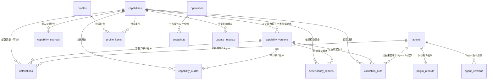

# AgentHub 数据模型

> 状态基准：2026-10-20 16:24，DB 为 **v2**（`SCHEMA_V1` + `SCHEMA_V2`）。以 `crates/agenthub-core/src/db.rs`、`model.rs`、`service.rs`/`ops.rs`/`mcp.rs` 与验证平台模块的实际读写路径为准。
> 阅读约定：**已验证** = 代码中存在且本次通读过实现；**未验证** = 结构存在但无调用方/无运行时验证；**已知限制** = 与设计目标存在偏差。

---

## 0. 结论摘要

1. AgentHub 只有 **一个 SQLite 数据库**（默认 `~/.agenthub/agenthub.db`），只存元数据；Skill 文件内容存放在库目录 `library/skills/<slug>/<hash12>/`，数据库不存二进制内容。
2. SQLite schema 分两版：`SCHEMA_V1`（`db.rs:14`）13 张表；`SCHEMA_V2`（`db.rs:195`）新增 **5 张验证平台表**；当前 `PRAGMA user_version = 2`。
3. 核心关系是 **`capabilities` → `capability_versions` → `installations`**；MCP 定义独立存 `mcp_definitions`，其部署记录仍写 `installations`（`kind='mcp'`）。
4. `installations` 的唯一键是 **`(agent_id, target_path, config_key)`**：Skill 安装的 `config_key=''`，MCP 安装的 `config_key=<server 名>`。这是「同一配置文件里放多个 MCP 条目」的关键设计（`db.rs:96`）。
5. MCP 的 **env 只存 key 名**（`env_keys`）与 Keychain 引用（`credential_refs`），明文值存 macOS Keychain；**分发的 `operations.plan` payload 已剥离 env 值**，执行时才从 Keychain 重建（`mcp.rs:883-890`、`mcp.rs:1111-1122`）。**headers 值仍明文入 `mcp_definitions.headers`**（见 §8）。
6. 迁移只依赖 `PRAGMA user_version`：`version<1` 建 V1，`version<2` 建 V2 并置 2，幂等、无降级保护（`db.rs:509-530`）。

---

## 1. 物理位置与数据分层

| 层 | 位置 | 内容 | 实现 |
|---|---|---|---|
| 数据库 | `<data_dir>/agenthub.db` | 全部注册表/安装/操作/快照元数据 | `service.rs:41-47` |
| Skill 内容库 | `<library_root>/library/skills/<slug>/<hash12>/` | 不可变版本副本（含 `SKILL.md` 与资源） | `library.rs:59-70`、`library.rs:93` |
| 操作快照 | `<library_root>/snapshots/<operation_id>/` | 写入前的目标备份（目录/文件） | `library.rs:72-78`、`ops.rs:595` |
| 完整备份 | `<library_root>/backups/backup-<timestamp>/` | `agenthub.db`（VACUUM INTO）+ `manifest.json` | `library.rs:122` |
| 导入暂存 | `<library_root>/staging/` | 导入/解压/克隆的临时工作区，Drop 时清理 | `skill.rs:341-371` |
| 日志目录 | `<library_root>/logs/` | `operations.log`：JSONL 审计（import/operation.start/finish/failed） | `ops.rs:24-44` |

默认值：`data_dir = ~/.agenthub`，`library_root` 默认等于 `data_dir`（`service.rs:41-45`、`service.rs:110-128`）。`library_root` 可在设置中改到其他空目录（`service.rs:391-415`），数据库始终留在 `data_dir`。

环境变量（测试隔离依赖）：

| 变量 | 作用 | 代码 |
|---|---|---|
| `AGENTHUB_HOME` | 覆盖「用户 home」——Agent 检测/roots 都基于它 | `service.rs:32-36` |
| `AGENTHUB_DATA_DIR` | 覆盖 `~/.agenthub` | `service.rs:37-40` |
| `AGENTHUB_EXTRA_APP_DIRS` | 追加 `.app` 探测目录（冒号分隔） | `adapters/mod.rs:181-187` |

---

## 2. 表结构（SCHEMA_V1 全文对照）

以下字段顺序、约束与 `db.rs:14-193` 一致。所有时间字段为 **RFC3339 UTC 秒精度文本**（`util.rs:17-19`）；所有 id 为 **UUID v4 字符串**（`util.rs:21-23`）；标注「JSON」的 TEXT 列由 `serde_json` 编码。

### 2.1 `settings` — 键值设置

| 列 | 类型 | 约束 |
|---|---|---|
| `key` | TEXT | PRIMARY KEY |
| `value` | TEXT | NOT NULL |
| `updated_at` | TEXT | NOT NULL |

已写入的 key：`library_root`、`default_strategy`、`language`、`theme`、`scan_on_startup`、`project_roots`（JSON 数组）、`initialized`、`git_import_enabled`、`last_scan_at`（`service.rs:110-128`、`service.rs:431`）。

### 2.2 `agents` — 已登记 Agent

| 列 | 类型 | 约束 | 说明 |
|---|---|---|---|
| `id` | TEXT | PK | 形如 `agent-codex`（`service.rs:142`） |
| `key` | TEXT | NOT NULL UNIQUE | 稳定 key（`codex`/`dsh`…） |
| `name` | TEXT | NOT NULL | 展示名 |
| `vendor` | TEXT | NOT NULL | 厂商 |
| `adapter_id` | TEXT | NOT NULL | 如 `builtin.codex` |
| `app_path` | TEXT | | 检测到的 `.app` 路径 |
| `home_path` | TEXT | | 检测到的配置目录 |
| `custom_skill_roots` | TEXT | NOT NULL DEFAULT `'[]'` | JSON 字符串数组，用户自定义根 |
| `notes` | TEXT | NOT NULL DEFAULT `'[]'` | JSON 字符串数组 |
| `created_at`/`updated_at` | TEXT | NOT NULL | |

`upsert_agent` 的冲突键是 `key`；更新时 `custom_skill_roots` 保留旧值、`app_path`/`home_path` 用 `COALESCE` 保留旧值（`db.rs:479-507`）。这意味着**适配器检测结果不会覆盖用户手工改过的路径**。

### 2.3 `capabilities` — 能力（当前只有 skill 会被写入）

| 列 | 类型 | 约束 |
|---|---|---|
| `id` | TEXT | PK |
| `kind` | TEXT | NOT NULL CHECK IN (`'skill'`,`'mcp'`,`'plugin'`) |
| `slug` | TEXT | NOT NULL |
| `name`/`description` | TEXT | NOT NULL / NOT NULL DEFAULT `''` |
| `current_version_id` | TEXT | 无外键（指向 `capability_versions.id`，逻辑引用） |
| `tags` | TEXT | NOT NULL DEFAULT `'[]'`，JSON 数组 |
| `license` | TEXT | |
| `created_at`/`updated_at` | TEXT | NOT NULL |

唯一约束：`UNIQUE (kind, slug)`（`db.rs:46`）。注意 **`current_version_id` 没有声明外键**，回滚/删除版本时不会被数据库级联检查。

### 2.4 `capability_versions` — 不可变版本

| 列 | 类型 | 约束 |
|---|---|---|
| `id` | TEXT | PK |
| `capability_id` | TEXT | NOT NULL REFERENCES `capabilities(id)` ON DELETE CASCADE |
| `version_label` | TEXT | NOT NULL（frontmatter 的 `version`，缺失时 `0.0.0+<hash12>`，`skill.rs:52-58`） |
| `content_hash` | TEXT | NOT NULL（sha256，目录内容哈希） |
| `storage_path` | TEXT | NOT NULL（库内绝对路径） |
| `manifest` | TEXT | NOT NULL DEFAULT `'{}'`（frontmatter 转成的 JSON） |
| `skill_md` | TEXT | NOT NULL DEFAULT `''`（正文全文，供详情页展示） |
| `size_bytes`/`file_count` | INTEGER | NOT NULL DEFAULT 0 |
| `notes` | TEXT | |
| `created_at` | TEXT | NOT NULL |
| `parent_version_id` | TEXT | 逻辑引用上一版本；**写入但从不读取**（`insert_version` 有参数，`VersionRow` 无该字段） |

唯一约束：`UNIQUE (capability_id, content_hash)`（`db.rs:62`）——同一内容重复导入直接复用。索引：`idx_versions_capability`。

### 2.5 `capability_sources` — 来源记录

| 列 | 类型 | 约束 |
|---|---|---|
| `id` | TEXT | PK |
| `capability_id` | TEXT | NOT NULL REFERENCES `capabilities(id)` ON DELETE CASCADE |
| `source_type` | TEXT | NOT NULL（`folder`/`agent_dir`/`skill_md`/`zip`/`git`） |
| `uri` | TEXT | NOT NULL |
| `reference` | TEXT | git 分支或 agent key |
| `imported_at` / `last_checked_at` | TEXT | NOT NULL / 可空 |
| `metadata` | TEXT | NOT NULL DEFAULT `'{}'`，当前恒为空对象 |

索引 `idx_sources_capability`。`get_source` 只取 `ORDER BY imported_at DESC LIMIT 1`（`db.rs:758-777`），所以界面只展示最近一次来源；历史来源行保留。

### 2.6 `installations` — 部署事实表（核心）

| 列 | 类型 | 约束 | 说明 |
|---|---|---|---|
| `id` | TEXT | PK | |
| `capability_id` | TEXT | REFERENCES `capabilities(id)` ON DELETE CASCADE | MCP 行为 NULL |
| `version_id` | TEXT | REFERENCES `capability_versions(id)` | MCP 行为 NULL |
| `agent_id` | TEXT | NOT NULL REFERENCES `agents(id)` ON DELETE CASCADE | |
| `kind` | TEXT | NOT NULL | `skill` / `mcp` |
| `scope` | TEXT | NOT NULL DEFAULT `'global'` | 记录 `global`/`custom`；项目根经 custom root 安装时记 `custom`（见 §4 与 §8） |
| `strategy` | TEXT | NOT NULL | `symlink` / `copy` / `native`（MCP 写死 `native`，`mcp.rs:1106`） |
| `target_path` | TEXT | NOT NULL | 目标绝对路径 |
| `source_path` | TEXT | | 库内源目录 |
| `content_hash` | TEXT | | Skill：版本 hash；MCP：**条目** hash |
| `state` | TEXT | NOT NULL | `installed`/`disabled`/`missing`/`conflict`/`error` |
| `config_key` | TEXT | NOT NULL DEFAULT `''` | MCP server 名；Skill 为空串 |
| `installed_at` | TEXT | NOT NULL | |
| `verified_at`/`last_check_at` | TEXT | | |
| `metadata` | TEXT | NOT NULL DEFAULT `'{}'` | MCP 存 `{serverId, format, fileHash}` |

唯一索引：`UNIQUE (agent_id, target_path, config_key)`（`db.rs:96`）。`upsert_installation` 依赖该唯一索引做 `ON CONFLICT` 更新（`db.rs:885-923`）。普通索引：`capability_id`、`agent_id`。

三个关键语义：

- Skill 安装用 `find_installation`（固定 `config_key=''`，`db.rs:832-841`）。
- MCP 安装用 `find_mcp_installation(agent, target_path, config_key)`（`db.rs:804-822`）。
- `metadata.fileHash` 是**整份配置文件**写入后的 hash，用于 MCP 漂移检测；`content_hash` 是**单条目** canonical hash（`mcp.rs:366-369`、`service.rs:560-569`）。

### 2.7 `mcp_definitions` — Agent 无关的 MCP 定义

| 列 | 类型 | 约束 |
|---|---|---|
| `id` | TEXT | PK |
| `capability_id` | TEXT | REFERENCES `capabilities(id)` ON DELETE SET NULL；当前恒 NULL |
| `name` | TEXT | NOT NULL；`UNIQUE`（`idx_mcp_name`） |
| `description` | TEXT | NOT NULL DEFAULT `''` |
| `transport` | TEXT | NOT NULL（`stdio`/`http`/`sse`/`streamable_http`） |
| `command` | TEXT | |
| `args` | TEXT | NOT NULL DEFAULT `'[]'`，JSON 数组 |
| `url` | TEXT | |
| `headers` | TEXT | NOT NULL DEFAULT `'{}'`，JSON 对象（**明文值**） |
| `env_keys` | TEXT | NOT NULL DEFAULT `'[]'`，JSON 字符串数组（只有 key 名） |
| `credential_refs` | TEXT | NOT NULL DEFAULT `'[]'`，JSON 数组；**当前无读写逻辑** |
| `metadata` | TEXT | NOT NULL DEFAULT `'{}'`（来源/是否 AgentHub 托管） |
| `created_at`/`updated_at` | TEXT | NOT NULL |

### 2.8 `plugin_records` — 插件只读注册表

| 列 | 类型 | 约束 |
|---|---|---|
| `id` | TEXT | PK |
| `agent_id` | TEXT | NOT NULL REFERENCES `agents(id)` ON DELETE CASCADE |
| `name` | TEXT | NOT NULL |
| `version`/`source` | TEXT | |
| `install_state` | TEXT | NOT NULL |
| `managed_by` | TEXT | NOT NULL（`file_managed`/`discovery_only`/`manual_only`…） |
| `permissions` | TEXT | NOT NULL DEFAULT `'[]'` |
| `official_url`/`discovered_path` | TEXT | |
| `metadata` | TEXT | NOT NULL DEFAULT `'{}'`（当前只存 `notes`） |
| `created_at`/`updated_at` | TEXT | NOT NULL |

唯一约束：`UNIQUE (agent_id, name)`（`db.rs:132`）。只由 `sync_plugins()` 写入（`service.rs:1628-1698`），不做任何安装动作。

### 2.9 `profiles` / `profile_items` — 预设

`profiles`：`id` PK、`name` NOT NULL UNIQUE、`description` NOT NULL DEFAULT `''`、`is_builtin` INTEGER NOT NULL DEFAULT 0、`created_at`/`updated_at`。

`profile_items`：`id` PK、`profile_id` NOT NULL REFERENCES `profiles(id) ON DELETE CASCADE`、`capability_id` NOT NULL REFERENCES `capabilities(id) ON DELETE CASCADE`、`enabled` INTEGER NOT NULL DEFAULT 1、`target_agents` TEXT NOT NULL DEFAULT `'[]'`（存 agent **key** 而非 id）、`UNIQUE (profile_id, capability_id)`。

启动时若 `profiles` 为空会种入 4 个内置预设：Coding / Research / Writing / Marketing，均为空 items（`service.rs:1702-1722`）。

### 2.10 `operations` — 操作日志（计划即操作行）

| 列 | 类型 | 约束 |
|---|---|---|
| `id` | TEXT | PK |
| `kind` | TEXT | NOT NULL（12 种，见 `model.rs:120-133`） |
| `status` | TEXT | NOT NULL（`planned`/`running`/`success`/`partial`/`failed`/`rolled_back`） |
| `dry_run` | INTEGER | NOT NULL DEFAULT 0；创建计划时恒 1，执行后不翻转（`db.rs:1230-1245`） |
| `actor` | TEXT | NOT NULL DEFAULT `'user'` |
| `summary` | TEXT | NOT NULL DEFAULT `''` |
| `plan` | TEXT | NOT NULL DEFAULT `'{}'`（完整 `OperationPlan` JSON） |
| `result` | TEXT | NOT NULL DEFAULT `'{}'`（`OperationResult` JSON） |
| `error` | TEXT | |
| `rollback_of` | TEXT | 逻辑指向被回滚的操作 |
| `started_at`/`finished_at` | TEXT | NOT NULL / 可空 |

索引 `idx_operations_started (started_at DESC)`。计划阶段先 `insert` 一行（`dry_run=1,status=planned`），执行阶段复用同一行更新状态（`service.rs:1211-1242`、`ops.rs:94-105`）。

### 2.11 `snapshots` — 快照索引

| 列 | 类型 | 约束 |
|---|---|---|
| `id` | TEXT | PK |
| `operation_id` | TEXT | NOT NULL REFERENCES `operations(id)` ON DELETE CASCADE |
| `kind` | TEXT | NOT NULL（`absent`/`dir`/`file`/`symlink`） |
| `original_path` | TEXT | NOT NULL |
| `backup_path` | TEXT | NOT NULL（symlink 时存**链接目标**，不是备份文件路径） |
| `existed` | INTEGER | NOT NULL |
| `hash_before` | TEXT | |
| `created_at` | TEXT | NOT NULL |

索引 `idx_snapshots_operation`。注意 `kind='absent'` 时 `backup_path=''`（`ops.rs:607-615`）。

### 2.12 `scan_results` — 扫描缓存

| 列 | 类型 | 约束 |
|---|---|---|
| `id` | TEXT | PK |
| `agent_id` | TEXT | 可空（无外键） |
| `scope` | TEXT | 可空；写入 `global`/`project`/`custom`（`scan.rs:137`） |
| `path` | TEXT | NOT NULL |
| `kind` | TEXT | NOT NULL（当前只写 `skill`） |
| `status` | TEXT | NOT NULL（`ok`/`invalid`） |
| `fingerprint` | TEXT | 内容 hash |
| `payload` | TEXT | NOT NULL DEFAULT `'{}'`（`DiscoveredSkill` JSON） |
| `scanned_at` | TEXT | NOT NULL |

索引 `idx_scan_agent`。每个 Agent 扫描时在事务里 **先删后插**（`db.rs:1356-1378`），因此它是缓存而非历史；写入时把 root 的 `scope` 落库（`scan.rs:137`、`scan.rs:177`）；全局最近扫描时间从该表 `MAX(scanned_at)` 取（`db.rs:1437-1445`）。

---

### 2.13 `capability_audits` — 静态/环境审计历史（V2）

| 列 | 类型 | 约束 |
|---|---|---|
| `id` | TEXT | PRIMARY KEY |
| `capability_id` | TEXT | NOT NULL REFERENCES `capabilities(id)` ON DELETE CASCADE |
| `version_id` | TEXT | NOT NULL REFERENCES `capability_versions(id)` ON DELETE CASCADE |
| `kind` | TEXT | NOT NULL（`static` / `environment`） |
| `status` | TEXT | NOT NULL（`pass` / `warn` / `fail` / `unknown`） |
| `risk` | TEXT | NOT NULL（`low` / `medium` / `high` / `critical`） |
| `summary` | TEXT | NOT NULL DEFAULT `''` |
| `findings` | TEXT | NOT NULL DEFAULT `'[]'`（`AuditFinding` JSON 数组） |
| `created_at` | TEXT | NOT NULL |

索引：`idx_audits_capability(capability_id, version_id, created_at DESC)`。每次审计**追加**一行；健康读取最新行。`findings.detail` 对凭据值脱敏。

### 2.14 `dependency_reports` — 依赖/环境检查历史（V2）

| 列 | 类型 | 约束 |
|---|---|---|
| `id` | TEXT | PRIMARY KEY |
| `capability_id` | TEXT | NOT NULL REFERENCES `capabilities(id)` ON DELETE CASCADE |
| `version_id` | TEXT | NOT NULL REFERENCES `capability_versions(id)` ON DELETE CASCADE |
| `status` | TEXT | NOT NULL（`healthy` / `needs_attention` / `unknown`） |
| `risk` | TEXT | NOT NULL |
| `summary` | TEXT | NOT NULL DEFAULT `''` |
| `items` | TEXT | NOT NULL DEFAULT `'[]'`（`DependencyItem` JSON 数组） |
| `checked_at` | TEXT | NOT NULL |

索引：`idx_deps_capability(capability_id, version_id, checked_at DESC)`。

### 2.15 `update_impacts` — 更新影响缓存（V2）

| 列 | 类型 | 约束 |
|---|---|---|
| `id` | TEXT | PRIMARY KEY |
| `capability_id` | TEXT | NOT NULL REFERENCES `capabilities(id)` ON DELETE CASCADE |
| `from_version_id` | TEXT | NOT NULL（逻辑指向 `capability_versions.id`，未声明外键） |
| `to_version_id` | TEXT | NOT NULL（同上） |
| `risk` | TEXT | NOT NULL |
| `summary` | TEXT | NOT NULL DEFAULT `''` |
| `payload` | TEXT | NOT NULL DEFAULT `'{}'`（完整 `UpdateImpact` JSON：fileChanges/classes/findings/scope） |
| `created_at` | TEXT | NOT NULL |

索引：`idx_impacts_capability(capability_id, created_at DESC)`。同一 `(from,to)` 复用最近一条并重新附加 affected scope。

### 2.16 `validation_runs` — 验证证据（V2）

| 列 | 类型 | 约束 |
|---|---|---|
| `id` | TEXT | PRIMARY KEY |
| `capability_id` | TEXT | NOT NULL REFERENCES `capabilities(id)` ON DELETE CASCADE |
| `version_id` | TEXT | NOT NULL REFERENCES `capability_versions(id)` ON DELETE CASCADE |
| `agent_id` | TEXT | REFERENCES `agents(id)` ON DELETE SET NULL（可空 = Agent 无关） |
| `kind` | TEXT | NOT NULL（`manual` / `static` / `environment` / `regression`） |
| `status` | TEXT | NOT NULL（`passed` / `failed` / `needs_attention` / `unverified`） |
| `case_name` | TEXT | NOT NULL |
| `notes` | TEXT | NOT NULL DEFAULT `''`（用户输入） |
| `evidence` | TEXT | NOT NULL DEFAULT `''`（用户输入；可能含日志片段/链接） |
| `actor` | TEXT | NOT NULL DEFAULT `'user'` |
| `created_at` | TEXT | NOT NULL |

索引：`idx_validations_capability(capability_id, created_at DESC)`。只有 `kind=manual AND status=passed` 且当前版本、每个已安装 Agent 都有记录时才贡献 `verified`；旧版本证据失效。

### 2.17 `agent_versions` — Agent 版本观测（V2）

| 列 | 类型 | 约束 |
|---|---|---|
| `id` | TEXT | PRIMARY KEY |
| `agent_id` | TEXT | NOT NULL REFERENCES `agents(id)` ON DELETE CASCADE |
| `version` | TEXT | 可空（探测失败时为 NULL，不伪造） |
| `previous_version` | TEXT | 可空 |
| `changed` | INTEGER | NOT NULL DEFAULT 0（首次 baseline=false） |
| `evidence` | TEXT | NOT NULL DEFAULT `''`（探测来源，如 agent key） |
| `detected_at` | TEXT | NOT NULL |

索引：`idx_agent_versions_agent(agent_id, detected_at DESC)`。读取最新行使用 `ORDER BY detected_at DESC, rowid DESC`（同秒排序回归已修复）。

---

## 3. 关系说明：capabilities vs capability_versions vs installations



- **V2 表是「证据」**：`capability_audits`/`dependency_reports` 按版本追加历史；`update_impacts` 按版本对缓存；`validation_runs` 绑定版本+Agent；`agent_versions` 是 Agent 维度的时间序列。
- **`capabilities` 是「身份」**：同一 `(kind, slug)` 只有一行；`slug` 来自 frontmatter `name` 经 `safe_segment()` 归一化（`skill.rs:47-49`、`util.rs:320-335`）。
- **`capability_versions` 是「内容」**：内容哈希唯一，导入相同内容不会生成新版本；不同内容生成新版本并把 `capabilities.current_version_id` 指向它（`service.rs:696-794`）。版本行不可变，库目录也不可变。
- **`installations` 是「事实」**：回答「某 Agent 的某个路径上现在装了什么」。它同时记录 `version_id`（意图）与 `content_hash`（写入时实际内容），所以能检测漂移：实际目录 hash ≠ 记录 hash 时标 `conflict`（`service.rs:545-610`）。
- **`capabilities.current_version_id` 与 `installations.version_id` 可以不同**：前者是库内最新，后者是各 Agent 上已部署版本，这正是 `update_available` 的来源（`service.rs:463-465`）。

---

## 4. `config_key` 与唯一索引

`config_key` 是为 MCP 引入的「文件内条目键」：

| 场景 | `target_path` | `config_key` | 结果 |
|---|---|---|---|
| Skill 安装 | `~/.codex/skills/<slug>` | `''`（默认） | 每个目录一行 |
| MCP 安装 | `~/.codex/config.toml` | `smoke-server` | 同一文件可有多行、每行一个 server |
| MCP 安装 | `~/Library/.../User/mcp.json` | `pkulaw` | 同上 |

唯一索引 `(agent_id, target_path, config_key)` 保证「同一 Agent 的同一文件里的同一 server 名只有一条记录」，从而使 `upsert_installation` 可安全重复执行（幂等）。`ops.rs:556-592` 的 Skill 安装走 `find_installation`（隐含 `config_key=''`），MCP 走 `find_mcp_installation`（显式 key）。

> `installations.scope` 现在写入规划时的 scope：`pick_install_root` 先 custom root（`custom`）、再 adapter install root（`global`）（`service.rs:1081-1120`）；`ops.rs` 用 `item.scope` 落库（`ops.rs:622`）。项目级安装仍按 custom root 处理，独立 project 流程未实现。

---

## 5. operations 与 snapshots

一次操作的完整生命周期（以 Skill 安装为例；导入是「无文件 PlanItem 的操作」，见第 7 步）：

1. **计划**：`plan_install` 生成 `OperationPlan`（含每个 `PlanItem` 的目标/动作/哈希/警告），插入 `operations` 行，`dry_run=1`、`status='planned'`，`plan` 列存整个 JSON（`service.rs:1211-1242`）。
2. **预检**：`preflight` 校验目标绝对路径、动作许可、外部修改（`ops.rs:200-292`）。
3. **快照**：每个 item 执行前把目标复制到 `snapshots/<operation_id>/NNN-<name>`，并写 `snapshots` 行；目标不存在则写 `kind='absent'`（`ops.rs:595-669`）。
4. **执行**：copy 走「staging 目录 + rename」，symlink 走 `symlink()`；失败立即恢复快照（`ops.rs:295-427`）。
5. **失败补偿**：任一 item 抛错时，把已成功的 item 逆序 `undo_item`，操作标记 `failed`（`ops.rs:133-174`）。
6. **回滚**：`rollback()` 只允许 `success`/`partial`，且每个原操作最多回滚一次；为回滚新建一条 `kind='rollback'`、`rollback_of=<原操作>` 的操作，逐 item 恢复快照与 `previous_installation`（`ops.rs:748-869`）。
7. **导入**：`import_skill` 成功后写入一条 `kind='import'`、`status='success'` 的 `operations` 行（items 为空、result 记库路径），并追加 `logs/operations.log` 的 `event=import`（`service.rs:800-860`）。扫描仍只刷新 `scan_results`，不写 operations。
8. **审计日志**：`operation.start`（operationId/kind/items/force）、`operation.finish`（status/items）、`operation.failed`（error）、`import`（capability/slug/version/hash）；**不记录 env/headers 值**（`ops.rs:24-44`）。

> `snapshots.kind='symlink'` 时 `backup_path` 保存的是**链接指向的原始路径**，恢复时重建同名链接（`ops.rs:630-637`、`ops.rs:676-682`）；它不会备份链接指向的内容。

---

## 6. scan_results 的定位

- 扫描是**只读 Agent 目录**的：唯一副作用是刷新 `scan_results`（`scan.rs:1-5`）。
- 它缓存「上一次扫描看到什么」，供 Agents 页显示每个 root 的技能数；`list_agents()` 从 `payload` 反序列化 `DiscoveredSkill` 并按 `root` 计数（`service.rs:195-214`）。
- 它与 `capabilities` **没有外键关系**：扫描到的外部技能可以不在库里；库里技能也可以不在任何 Agent 目录里。
- `scan_results.scope` 现在写入 `global`/`project`/`custom`（`scan.rs:137`、`scan.rs:177`），可用于按 scope 过滤；`payload` 中仍保留完整的 `DiscoveredSkill`。

---

## 7. 敏感数据策略（数据库视角）

| 数据 | 落库位置 | 是否明文 | 说明 |
|---|---|---|---|
| MCP env 变量名 | `mcp_definitions.env_keys` | 明文（只是名字） | 值存 Keychain，service `com.agenthub.mcp`，account `<server_id>/<key>`（`mcp.rs:22`、`mcp.rs:39-63`） |
| MCP env 变量值 | 不落 `mcp_definitions` | — | 仅在分发时从 Keychain 读出 |
| MCP headers | `mcp_definitions.headers` | **明文值** | 可能含 `Authorization`；见 §8 |
| MCP credential_refs | `mcp_definitions.credential_refs` | 明文（只是引用名） | **当前没有任何读写实现** |
| Skill 内容 | 文件系统库目录 | 明文 | `skill_md` 正文也复制一份进 `capability_versions.skill_md` |
| Agent 配置原文 | 快照目录 | 明文 | 快照是原始配置文件副本，可能已含 token |
| 操作计划 | `operations.plan` | 明文 JSON | MCP payload 已剥离 env 值；headers 仍会出现在 payload（见 §8） |
| 审计 findings | `capability_audits.findings` | 明文 JSON | 脚本片段会截断；凭据行只显示类型/行号（value redacted） |
| 依赖 items | `dependency_reports.items` | 明文 JSON | 只含 runtime/manifest/MCP 元数据，不含凭据值 |
| 更新影响 | `update_impacts.payload` | 明文 JSON | 文件路径/classes/findings；不含文件内容 |
| 验证证据 | `validation_runs.notes/evidence` | 明文，**用户输入** | 用户可能粘贴日志/链接；AgentHub 不脱敏、不防伪，UI 需提示 |
| Agent 版本 | `agent_versions.evidence` | 明文 | 探测来源说明（agent key）；不含命令输出全文 |

原则：**数据库不是密钥库**。Keychain 只是 env 值的唯一存储处；任何明文副本都应视为已知风险，而不是「已加密」。

---

## 8. 已知限制与未验证项

| 项 | 状态 | 说明 |
|---|---|---|
| ~~MCP env 值进入 `operations.plan`~~ | **已修复（2026-10-20）** | 计划阶段用空 env 构建持久化 payload（`mcp.rs:883-890`、`mcp.rs:959`），执行时从 Keychain 重建（`mcp.rs:1111-1122`）。注意：**headers 仍会进入 payload**。 |
| MCP headers 明文入库 | **已知限制** | `McpUpsertRequest.headers` 直接存 `mcp_definitions.headers`（`mcp.rs:712`），并原样写入 Agent 配置（`mcp.rs:466-474`）。 |
| `credential_refs` | **未验证/未实现** | 列存在、UI 模型存在，但没有 Keychain 绑定或解析逻辑。 |
| `capability_versions.parent_version_id` | **未验证** | 写入接口支持，查询接口不返回，未用于回滚或 diff。 |
| `capability_sources.metadata` | **未使用** | 恒为 `{}`。 |
| `installations.scope` | **部分实现** | 现在写入规划时的 scope（`ops.rs:622`、`service.rs:1116`）：custom root → `custom`，adapter install root → `global`。项目级安装仍按 custom root 处理，独立 project 流程未实现。 |
| `scan_results.scope` | **已实现** | 扫描写入 `global`/`project`/`custom`（`scan.rs:137`、`scan.rs:177`）；可用于按 scope 过滤。 |
| `operations.kind` 的 `import`/`scan`/`sync`/`update` | **部分实现** | `import` 已写入 operations 行；`sync`/`update` 通过 install 计划记录；`scan` 仍不写 operations（只刷新 `scan_results`）。 |
| V2 证据表 | **已实现** | audit/deps/impact/validation/agent_versions 由新服务写入；无 UI 删除/清理入口（保留历史）。 |
| 迁移 | **v1 → v2** | `migrate()` 依次执行 `version<1`、`version<2`；旧 v1 库自动建 V2 表并置 `user_version=2`，幂等；无降级保护（`db.rs:509-530`，回归测试 `v2_migration_rebuilds_tables_and_preserves_v1_data`）。 |
| 备份恢复 | **未实现** | `backups/` 会生成 DB 副本与 manifest，但没有「从备份恢复」的代码路径（`library.rs:122-223` 只有创建/列表）。另有 `logs/operations.log` 可作审计。 |
| 外键完整性 | **已验证声明** | `PRAGMA foreign_keys=ON`（`db.rs:432`），但 `capabilities.current_version_id`、`installations.version_id` 的删除行为依赖 SQLite 默认（无动作），删版本前需自行保证引用一致性。 |

---

## 9. 迁移策略（面向后续版本）

当前实现（`db.rs:509-530`）：

```text
version = PRAGMA user_version
if version < 1:
    BEGIN; execute_batch(SCHEMA_V1); PRAGMA user_version=1; COMMIT
version = PRAGMA user_version
if version < 2:
    BEGIN; execute_batch(SCHEMA_V2); PRAGMA user_version=2; COMMIT
```

约定（已用于 v2，后续沿用）：

1. 每个版本一个 `if version < N { ... }` 分支，**只前进、不降级**；旧版本 DB 打开时自动升级（v1→v2 已实现）。
2. 迁移必须在事务内完成；DDL 失败整体回滚。
3. 升级前自动创建 `backups/` 快照（当前未实现，属于待办）；真实 Mac 已验证 v1→v2。
4. 任何破坏性列变更采用「新表 + 数据搬迁 + 改名」，不要直接 `DROP COLUMN`。
5. `doctor()` 已用 `PRAGMA integrity_check` 做健康检查（`service.rs:1537-1556`），可作为迁移后的验收手段。

> 验证平台数据语义见 [VALIDATION.md](VALIDATION.md)。
